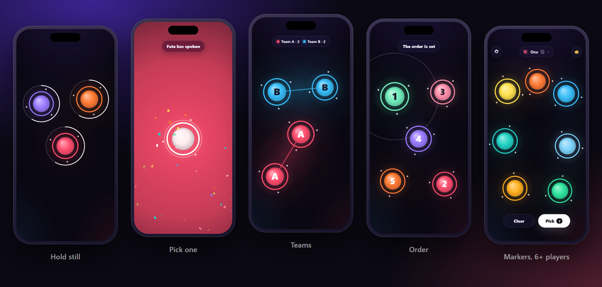
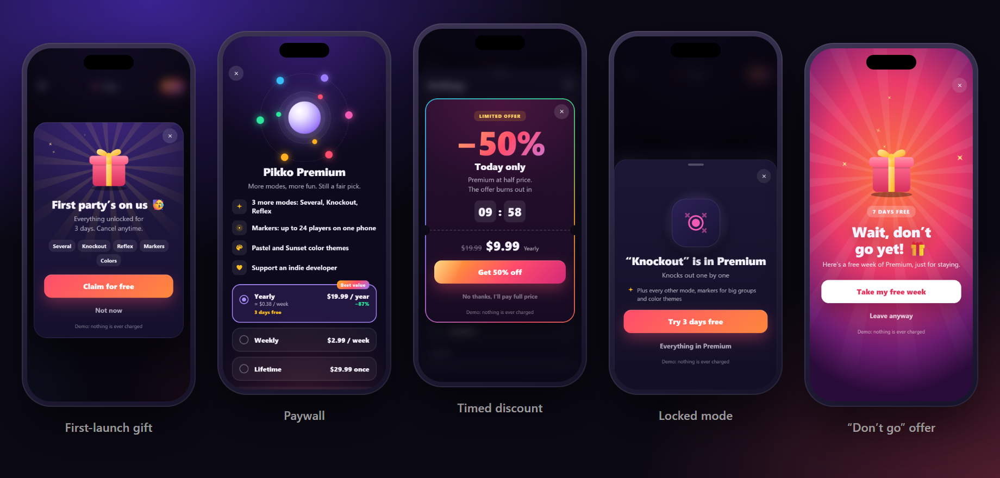

# Pikko — finger picker for iPhone

Everyone puts a finger on the screen. Every finger gets its own glowing orb, and once nobody moves for a moment, Pikko picks: who starts, who pays, who goes first. It is a PWA built to feel like a native App Store app: fluid animations, real multi-touch, sound, haptics where iOS allows them, offline support and a Home Screen install.

**Try it:** https://pikko-rose.vercel.app. On iPhone, open it in Safari, then Share → Add to Home Screen.



## Modes

| Mode | What happens | Access |
| --- | --- | --- |
| One | picks one player: the screen floods with their color, confetti | free |
| Teams | 2–4 even teams, letters A–D, lines between teammates | free |
| Order | numbers 1…N appear one by one | free |
| Several | picks 2–4 players | PRO |
| Knockout | a roulette knocks players out one by one until one is left | PRO |
| Reflex | “Get ready…” → “LIFT!”: the fastest finger wins, lifting early is a false start | PRO |
| Markers | for 6+ players: everyone taps once (up to 24), then press Pick | PRO |

The Pastel and Sunset color themes are PRO too. Picks use `crypto.getRandomValues` with rejection sampling, so every finger has the same chance. The UI speaks English, Russian and Ukrainian (auto or manual).

## Mock paywall



Nothing is ever charged: a “purchase” waits a second and flips a flag in `localStorage`.

| Screen | When it shows up |
| --- | --- |
| First-launch gift (3 days of Premium) | first launch |
| Full paywall (3 plans, free-trial switch, close button fades in after 2 s) | PRO button, every 3rd launch, every 8th round |
| −50% discount with a 10-minute timer | every 4th round |
| Locked-mode sheet | tapping a PRO mode, Markers or a PRO color theme |
| “Wait, don’t go yet!” (a free week) | coming back to the app after 30+ s (once a day), the `/?promo=stay` icon shortcut |

Each screen has 2–3 copy variants. A promo never interrupts a round: it waits until the screen is free. Settings → Promo screens (demo) opens every variant, can turn automatic promos off, and Reset everything replays the first launch.

## What iOS lets a web app do (checked November 2026)

- **Home Screen quick actions.** Native apps like Chooser put a “free trial” item in the long-press menu of their icon. A web app on iOS cannot: Safari on iOS ignores the manifest `shortcuts` (Safari on macOS has read them since 17.4), and the long-press menu of a web app shows only system items. Pikko still ships the shortcuts, and they work on Android and in desktop Chrome/Edge. On iPhone, the closest substitute is the “Wait, don’t go yet!” screen when you return to the app.
- **Multi-touch.** iPhone reports at most 5 simultaneous touches (iPad 11), for native apps too. A 6th finger makes iOS cancel every touch (`touchcancel`). Pikko catches that and suggests Markers. Settings → About shows the most fingers your device reported.
- **Haptics.** iOS has no Vibration API. On iOS 17.4–26.4, clicking a hidden `<input type="checkbox" switch>` from code plays the system tick. Since iOS 26.5 the tick only comes from a real tap on a switch, so Pikko lays invisible switches over its buttons and toggles. On current iOS the pick itself has no haptics. Android uses `navigator.vibrate`.
- **Sound.** All sounds are synthesized with Web Audio, no files. iOS starts audio only on `touchend` or a click, never on `touchstart`, so until the first tap the idle screen shows “Tap once to turn on sound”. `navigator.audioSession.type = 'ambient'` follows the silent switch and mixes with music.
- **120 Hz.** `requestAnimationFrame` in Safari and in Home Screen web apps is capped at 60 Hz by default. Every animation is time-based, so it looks the same at 60 and 120 Hz.
- **Launch screen.** iOS does not build one from the manifest. It needs an `apple-touch-startup-image` per screen size: 26 here, for 13 iPhone sizes × 2 orientations. WebKit bug 326500 makes `device-height` queries launch to a black screen on iOS 27.0.1, so the media queries use `device-width` + pixel ratio only.
- **No zoom, scroll, bounce or selection.** Pikko uses non-passive `touchstart`/`touchmove` listeners that call `preventDefault`, `touch-action: none` on the play area, a blocked `gesturestart`, `user-select`/`-webkit-touch-callout: none`, and a fixed body with `overscroll-behavior: none`. Sheets keep native scrolling.
- **Screen stays on.** Pikko uses the Screen Wake Lock API (in Home Screen web apps since iOS 18.4).

Sources: [firt.dev iOS PWA compatibility](https://firt.dev/notes/pwa-ios/), [ios-haptics](https://unpkg.com/ios-haptics@3.1.1/README.md), [WebKit bug 326500](https://bugs.webkit.org/show_bug.cgi?id=326500), [WebKit bug 272226](https://bugs.webkit.org/show_bug.cgi?id=272226), App Store listings of finger-chooser apps (5 touches on iPhone, 11 on iPad).

## Under the hood

Plain JavaScript modules and Canvas 2D, no framework. esbuild bundles about 105 KB of JS and 31 KB of CSS (before gzip). The service worker is hand-written: it precaches the app shell, versioned by a content hash.

```
src/engine.js   orbs, countdown, every mode, effects (Canvas 2D; the loop sleeps when idle)
src/input.js    multi-touch on the document (capture, non-passive); mouse: Shift-click adds a finger
src/ui.js       HUD, mode and settings sheets, install banner
src/promo.js    Premium mock, the 5 promo screens and their triggers
src/audio.js    Web Audio synth
src/haptics.js  vibrate / iOS switch tick
src/i18n.js     EN / RU / UK strings, prices in the region's currency
src/sw.js       service worker template
scripts/        build, gen-assets (icons + splash via Chrome), serve, test-e2e, gallery
```

```bash
npm install
npm run build    # dist/
npm run serve    # http://localhost:5199
npm test         # end-to-end checks in iPhone emulation
npm run assets   # redraw icons, splash screens and og.png (needs Chrome)
```

`node scripts/test-e2e.mjs <url> --shots [--lang=en-US]` runs 41 checks in Chrome's iPhone emulation against any URL. It uses real multi-touch through the DevTools protocol and Home Screen (standalone) mode. It covers every mode and promo screen, the 6th-finger cancel, offline reload, no zoom or scroll, and touch scrolling in sheets. Screenshots go to `test-shots/`, and `node scripts/gallery.mjs` turns them into the images above.

Name, icon and artwork are original; only the genre’s mechanic is shared with other finger choosers.
